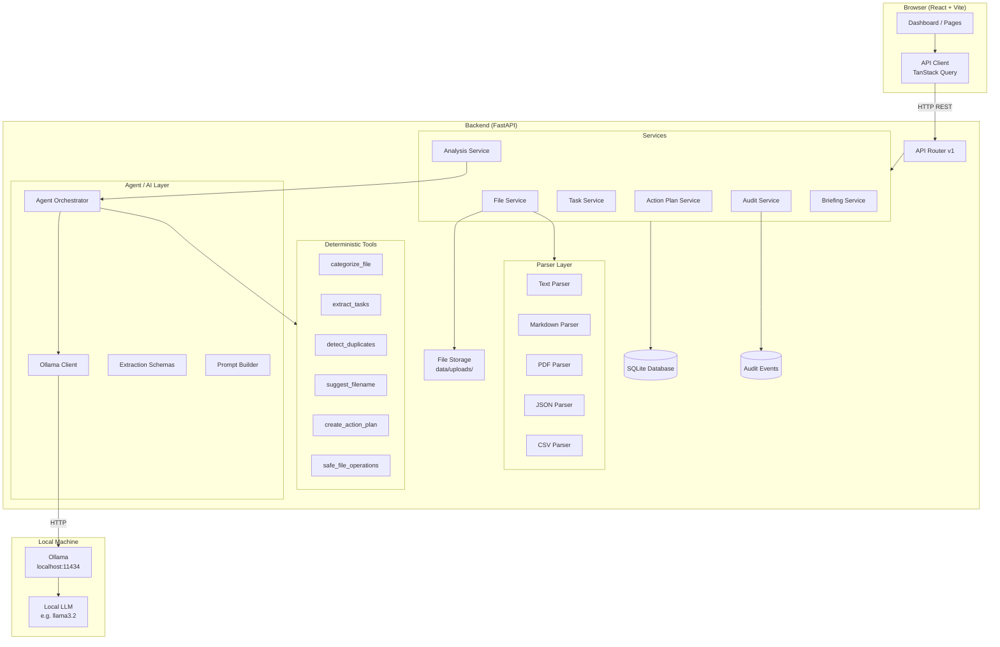
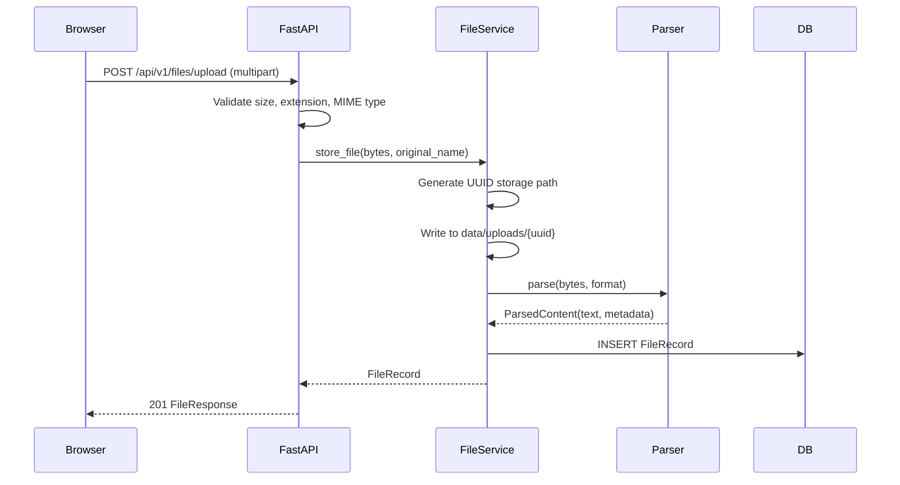
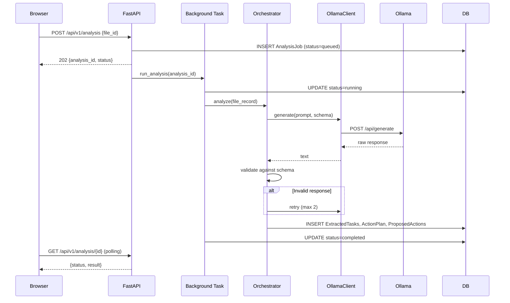
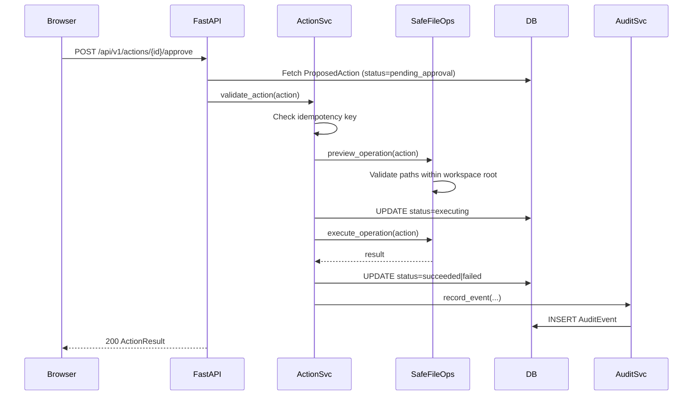
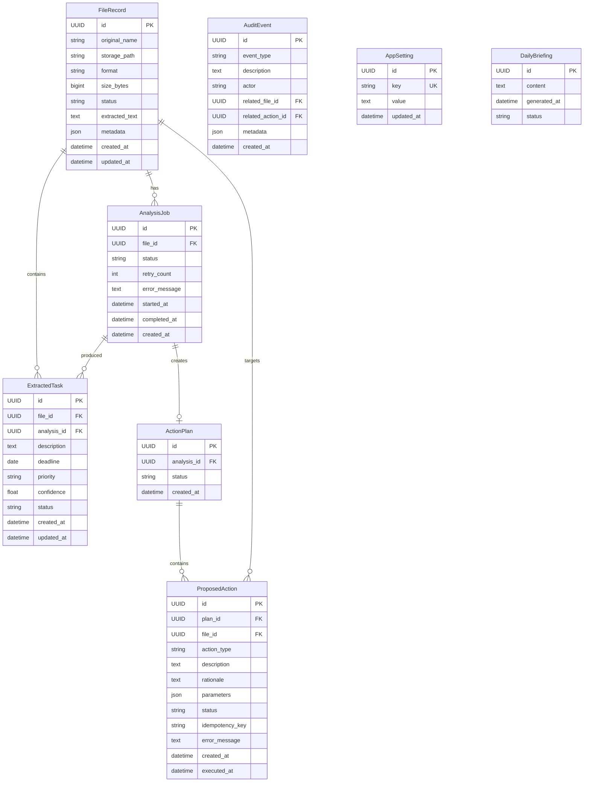

# ARCHITECTURE.md — LazyOps AI

> **Version:** 0.1.0-mvp
> Keep this document synchronized with the actual implementation.

---

## A. Architecture Overview

LazyOps AI is a **local-first modular monolith** deployed as two processes: a FastAPI backend and a Vite/React frontend. All AI inference is delegated to a locally running [Ollama](https://ollama.com) instance.

**System boundary:**
- The backend communicates with Ollama via HTTP on localhost only
- No external network requests are made by the backend (unless the user explicitly enables a cloud-model provider in a future release)
- Files are stored within a single configurable data directory — never outside it
- The browser communicates only with the FastAPI backend

**Why a modular monolith for the MVP?**
- Simpler deployment (two processes, one SQLite file)
- Easier to understand and contribute to
- No distributed system complexity before it is needed
- Services can be extracted if scale demands it later

---

## B. Architecture Diagram



---

## C. Component Responsibilities

### React Frontend

| Attribute | Value |
|-----------|-------|
| Responsibility | Render UI, call backend APIs, display job status, handle approval/rejection |
| Inputs | User actions, backend JSON responses |
| Outputs | API requests, rendered UI state |
| Dependencies | FastAPI backend, React Router, TanStack Query |
| Error Behavior | Show error states, retry on transient failures |
| Security | CORS enforced on backend; no secrets in frontend |
| Source Files | `frontend/src/**` |

### FastAPI Backend

| Attribute | Value |
|-----------|-------|
| Responsibility | Validate requests, orchestrate services, return structured responses |
| Inputs | HTTP requests from browser |
| Outputs | JSON responses, database mutations, file operations |
| Dependencies | SQLite, Ollama, local filesystem |
| Error Behavior | Structured error responses with codes |
| Security | Path validation, CORS, rate limits, input size limits |
| Source Files | `backend/app/main.py`, `backend/app/api/**` |

### File Service

| Attribute | Value |
|-----------|-------|
| Responsibility | Store uploaded files, validate types/sizes, invoke parsers, manage metadata |
| Inputs | Raw uploaded bytes + filename |
| Outputs | `FileRecord` with extracted text and metadata |
| Dependencies | Parser layer, filesystem, DB |
| Error Behavior | Reject invalid files; record parsing errors |
| Security | UUID storage names; path traversal rejection; size limits |
| Source Files | `backend/app/services/file_service.py` |

### Parser Layer

| Attribute | Value |
|-----------|-------|
| Responsibility | Extract plain text and metadata from each supported format |
| Inputs | File bytes + declared MIME type |
| Outputs | `ParsedContent(text, metadata, word_count, error)` |
| Dependencies | `pypdf`, standard library |
| Error Behavior | Return error in result; do not raise uncaught exceptions |
| Security | Treat extracted text as untrusted input; size-limit output |
| Source Files | `backend/app/parsers/**` |

### Agent Orchestrator

| Attribute | Value |
|-----------|-------|
| Responsibility | Coordinate AI analysis: invoke Ollama, validate output, create action plans |
| Inputs | `AnalysisJob` + parsed file content |
| Outputs | `ExtractedTask[]`, `ProposedAction[]`, `ActionPlan` |
| Dependencies | Ollama client, tools, DB |
| Error Behavior | Bounded retry on invalid output; mark job failed if all retries exhausted |
| Security | Never executes actions; only proposes them |
| Source Files | `backend/app/ai/orchestrator.py` |

### Ollama Client

| Attribute | Value |
|-----------|-------|
| Responsibility | HTTP communication with local Ollama API |
| Inputs | Model name, prompt, optional JSON schema |
| Outputs | Raw model text response |
| Dependencies | `httpx` |
| Error Behavior | Timeout → `OllamaTimeoutError`; unavailable → `OllamaUnavailableError` |
| Security | Connects to configured URL only; no credentials stored |
| Source Files | `backend/app/ai/ollama_client.py` |

### Deterministic Tools

| Attribute | Value |
|-----------|-------|
| Responsibility | Execute safe, bounded operations: hashing, path ops, normalization |
| Inputs | Typed Python values |
| Outputs | Typed Python results |
| Dependencies | Standard library, `hashlib` |
| Error Behavior | Raise typed exceptions caught by orchestrator |
| Security | No shell execution; no arbitrary code evaluation |
| Source Files | `backend/app/tools/**` |

### Audit Service

| Attribute | Value |
|-----------|-------|
| Responsibility | Record all significant events to the database |
| Inputs | Event type, description, actor, related entity IDs |
| Outputs | `AuditEvent` persisted to DB |
| Dependencies | DB |
| Error Behavior | Log failure but do not block primary operation |
| Security | Does NOT store document contents; stores only metadata |
| Source Files | `backend/app/services/audit_service.py` |

---

## D. Request and Execution Flows

### 1. File Upload and Parsing



### 2. AI Analysis



### 3. Action Approval and Execution



---

## E. API Contract

All endpoints are prefixed with `/api/v1`.

### Error Format

```json
{
  "error": {
    "code": "MODEL_UNAVAILABLE",
    "message": "The configured Ollama model is not available.",
    "detail": "Model 'llama3.2' not found. Run: ollama pull llama3.2",
    "request_id": "req_abc123"
  }
}
```

### Endpoints

| Method | Path | Description | Status Codes |
|--------|------|-------------|--------------|
| GET | `/api/v1/health` | Backend health check | 200 |
| GET | `/api/v1/ai/status` | Ollama connection and model status | 200 |
| GET | `/api/v1/ai/models` | Available Ollama models | 200 |
| POST | `/api/v1/files/upload` | Upload and parse a file | 201, 413, 422 |
| GET | `/api/v1/files` | List all file records | 200 |
| GET | `/api/v1/files/{file_id}` | Get file details | 200, 404 |
| DELETE | `/api/v1/files/{file_id}` | Delete file and its data | 204, 404 |
| POST | `/api/v1/analysis` | Start analysis job | 202, 404, 422 |
| GET | `/api/v1/analysis/{analysis_id}` | Poll analysis status | 200, 404 |
| GET | `/api/v1/tasks` | List extracted tasks | 200 |
| PATCH | `/api/v1/tasks/{task_id}` | Edit or dismiss a task | 200, 404 |
| GET | `/api/v1/action-plans` | List action plans | 200 |
| GET | `/api/v1/action-plans/{plan_id}` | Get plan with actions | 200, 404 |
| POST | `/api/v1/actions/{action_id}/approve` | Approve a proposed action | 200, 404, 409 |
| POST | `/api/v1/actions/{action_id}/reject` | Reject a proposed action | 200, 404, 409 |
| GET | `/api/v1/activity` | Audit event history | 200 |
| GET | `/api/v1/settings` | Get application settings | 200 |
| PATCH | `/api/v1/settings` | Update settings | 200, 422 |
| GET | `/api/v1/briefing` | Get most recent daily briefing | 200 |
| POST | `/api/v1/briefing/generate` | Trigger briefing generation | 202 |

---

## F. Data Model

### Entity Relationship



### Status Transitions

```
AnalysisJob:    queued → running → completed | failed | cancelled
ProposedAction: pending_approval → approved | rejected
                approved → executing → succeeded | failed
FileRecord:     pending → parsed | parse_failed
```

---

## G. Agent Design

### Agent Lifecycle

1. Triggered by `POST /api/v1/analysis`
2. `AnalysisJob` created in DB with `status=queued`
3. FastAPI background task invokes `AgentOrchestrator.run(job_id)`
4. Orchestrator fetches file content, builds bounded prompt
5. Ollama returns JSON; schema validated; retry on failure (max 2)
6. Tools run deterministically on validated output
7. `ActionPlan` + `ProposedAction[]` stored in DB
8. Job marked `completed`; user polls for status

### Tool Registry

| Tool | Permission | Inputs | Outputs |
|------|-----------|--------|---------|
| `categorize_file` | Read-only | file text, metadata | category, confidence |
| `extract_tasks` | Read-only | file text | task list |
| `normalize_deadline` | Read-only | date string | ISO date or null |
| `detect_duplicate_candidates` | Read-only | file hash, all file hashes | duplicate list |
| `suggest_filename` | Read-only | file text, metadata | filename suggestion |
| `create_action_plan` | Write (DB only) | analysis results | ActionPlan |
| `preview_file_operation` | Read-only (filesystem) | action params | preview result |
| `execute_approved_file_operation` | Write (filesystem, restricted) | approved action | execution result |

### Safety Constraints

- The model **never** executes tools directly
- Tool results are returned to the orchestrator which validates and persists them
- File operations are gated by both a Python authorization check **and** an approval record in the DB
- Maximum tool iterations per analysis: 10
- Maximum Ollama retry attempts: 2
- Maximum response size: 16 KB
- Ollama request timeout: 120 seconds

---

## H. Privacy and Security

### Local-First Data Flow

- Files are stored locally in `APP_DATA_DIR/uploads/`
- Ollama runs locally at `http://127.0.0.1:11434`
- No external HTTP calls are made by the application
- **Important:** This is local inference, not air-gapped. Dependencies require internet during setup. The Ollama daemon itself may check for updates.

### Network Boundary Assumptions

- Backend binds to `127.0.0.1` by default for local-only use
- If exposed to a LAN, authentication must be added (not in MVP scope)
- CORS is restricted to configured origins (default: `http://localhost:5173`)

### File Security

- Storage names are UUID4 strings — no user input reaches the filesystem as a path component
- All paths are resolved with `pathlib.Path.resolve()` and validated against the workspace root
- Symlinks that escape the workspace root are rejected
- File type is validated by extension and (where practical) magic bytes

### Prompt Injection Defense

- Extracted document text is treated as untrusted data
- System prompt uses a clear delimiter before injected content
- Model output is validated against a strict schema — arbitrary instructions in document text cannot override schema requirements
- The orchestrator never evaluates or executes text produced by the model

### Telemetry

- No analytics, telemetry, crash reporting, or external logging by default
- All data stays on the local machine

---

## I. Error Handling and Observability

### Error Codes

| Code | HTTP Status | Meaning |
|------|-------------|---------|
| `HEALTH_OK` | 200 | Service is healthy |
| `MODEL_UNAVAILABLE` | 503 | Ollama model not found or not running |
| `OLLAMA_TIMEOUT` | 504 | Model inference timed out |
| `INVALID_MODEL_RESPONSE` | 500 | Model output failed schema validation after retries |
| `FILE_TOO_LARGE` | 413 | Upload exceeds size limit |
| `UNSUPPORTED_FORMAT` | 422 | File format not supported |
| `PARSE_FAILED` | 422 | Parser could not extract text |
| `NOT_FOUND` | 404 | Entity not found |
| `INVALID_STATE` | 409 | Entity is in wrong state for requested operation |
| `PATH_VIOLATION` | 422 | Path traversal or symlink escape attempt |
| `ACTION_ALREADY_EXECUTED` | 409 | Action idempotency: already executed |
| `VALIDATION_ERROR` | 422 | Request body failed validation |

### Job Status Logging

Status transitions are persisted to the database. The backend logs at `INFO` level for lifecycle events and `ERROR` level for unexpected failures. Full document content is never logged.

---

## J. Testing and Deployment

### Test Layers

| Layer | Tool | Location |
|-------|------|----------|
| Backend unit | pytest | `backend/tests/unit/` |
| Backend API | pytest + httpx | `backend/tests/api/` |
| AI mock | pytest | `backend/tests/ai/` |
| Frontend unit | Vitest + RTL | `frontend/src/test/` |

### Local Setup

```bash
# Backend
cd backend
python -m venv .venv
.venv/Scripts/activate  # Windows
pip install -e ".[dev]"
alembic upgrade head
uvicorn app.main:app --reload

# Frontend
cd frontend
npm install
npm run dev
```

### Environment Variables

See `.env.example` at the repository root.

### Docker (Optional)

```bash
docker compose up
```

---

## K. Architecture Decision Records

### ADR-001: Why Ollama?

Ollama provides a simple HTTP API for local LLM inference on all major platforms. It supports many open-weight models and requires no API key. It is the most accessible local inference solution for the target audience.

**Alternatives considered:** llama.cpp (more complex), Hugging Face Transformers (larger dependency footprint), LM Studio (no API).

### ADR-002: Why FastAPI?

FastAPI provides automatic OpenAPI documentation, excellent async support, Pydantic integration for request/response validation, and dependency injection. It is the modern Python API standard.

### ADR-003: Why SQLite?

SQLite requires zero infrastructure, works on all platforms, and is appropriate for a local single-user application. It can be replaced with PostgreSQL if multi-user or high-concurrency requirements emerge.

### ADR-004: Why a Modular Monolith?

Microservices would add deployment complexity, network latency, and distributed system challenges without benefit at this scale. Services are modular enough to extract later.

### ADR-005: Why Deterministic Tools + Model Reasoning?

The model provides reasoning and suggestions. Deterministic Python tools perform actual operations. This separation ensures that model hallucinations cannot cause unauthorized actions. Human approval provides an additional safety gate.

### ADR-006: Why Human Approval for File Modifications?

File operations are irreversible (rename, move, delete). Requiring explicit approval for each file modification protects users from incorrect AI suggestions and builds trust in the system.
