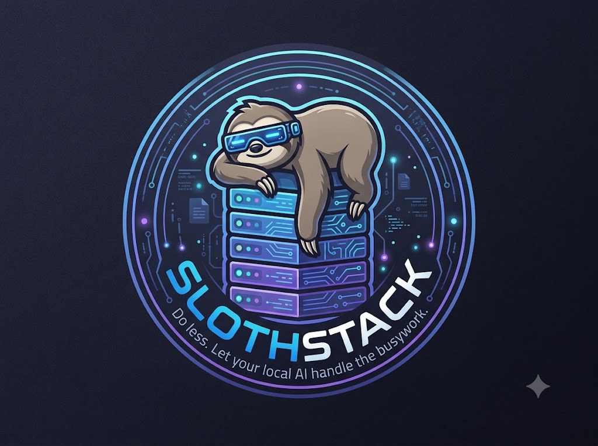
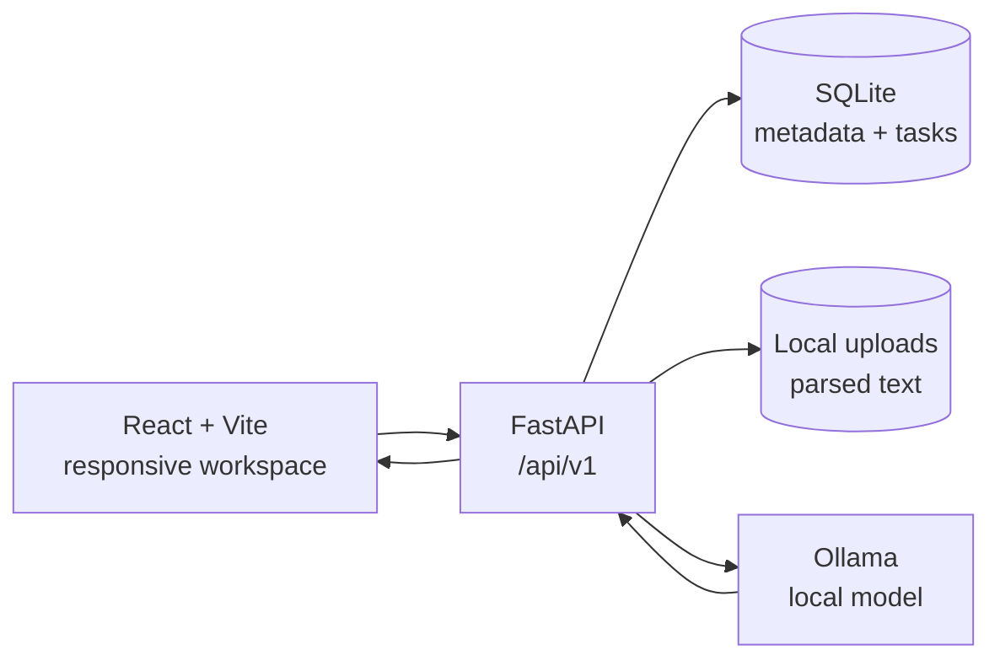
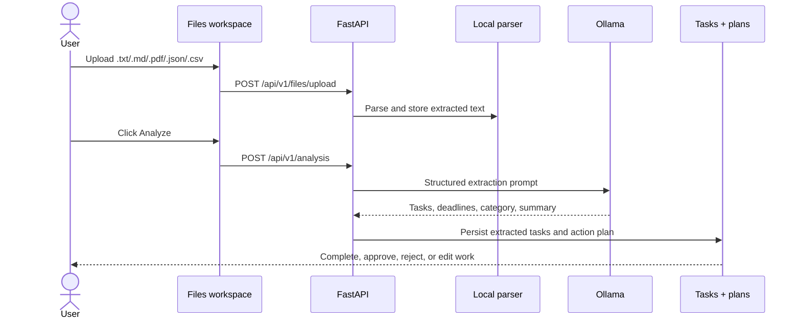
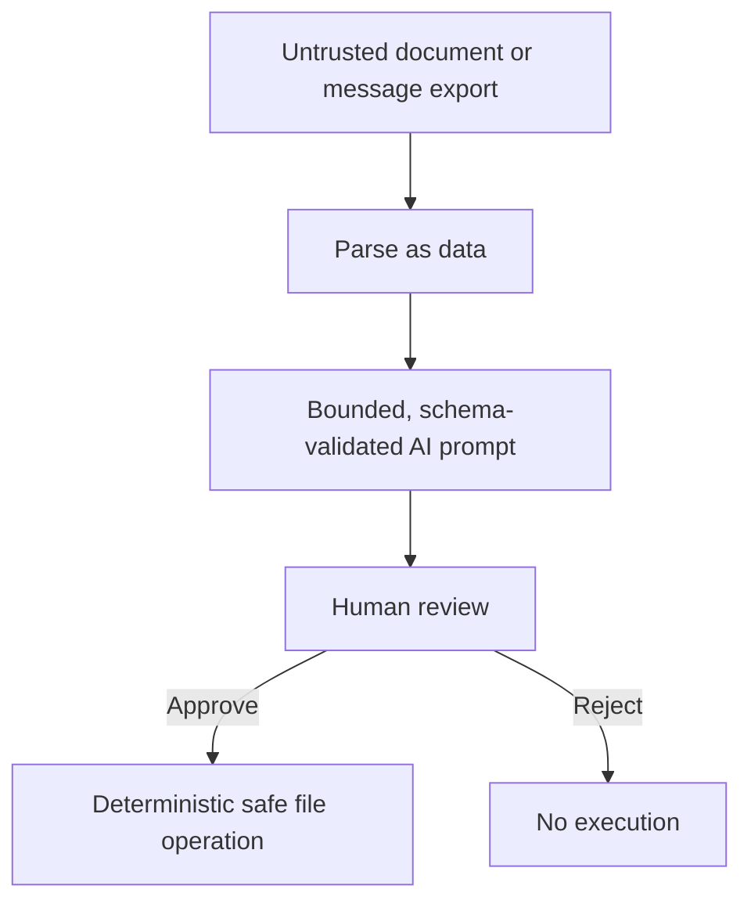

# Sloth Stack

> **Do less. Let your local AI handle the busywork.**

Sloth Stack is a local-first productivity workspace that turns inbox exports,
documents, and visual notes into useful, reviewable work. Upload a mail export,
analyze it with Ollama, review extracted tasks and deadlines, then approve safe
file actions. Your data stays in the local SQLite database and upload directory.



## What it does

| Workspace | Purpose |
| --- | --- |
| **Dashboard** | Content-grounded daily briefing, workload counters, and priorities |
| **Files** | Upload mail exports and documents, then start local AI analysis |
| **Tasks** | Review extracted mail tasks, complete them, or create custom deadline-aware todos |
| **Action plans** | Approve or reject safe proposed actions and use the interactive planning notebook |
| **Activity** | Inspect the local audit trail |
| **Settings** | Configure Ollama and open Gmail, WhatsApp Web, or Slack |

### Import a mailbox or message export

Download the safe demo file from
[frontend/public/sloth-stack-inbox-sample.txt](./frontend/public/sloth-stack-inbox-sample.txt),
upload it from **Files**, and select **Analyze**. The analyzer extracts explicit
actions such as design reviews, invoice downloads, and sprint updates while
preserving the original wording of relative deadlines like “tomorrow” and
“before Monday”.

For a fuller demo, use
[frontend/public/sloth-stack-demo-briefing.txt](./frontend/public/sloth-stack-demo-briefing.txt).
It contains five explicit actions with relative and calendar deadlines. Uploading
from the Files page now starts analysis automatically; the resulting tasks appear
in **Tasks**, where extracted tasks can be edited or completed and browser-saved
custom todos can be edited, completed, and deleted.

> Gmail, WhatsApp Web, and Slack buttons open their official web apps. They do
> not collect credentials or silently scrape messages. Export or copy messages
> locally before analysis.

### Deploy the frontend to Vercel

Set the Vercel project root to `frontend`. The included
[frontend/vercel.json](./frontend/vercel.json) configures the Vite build and
client-side routes. Set the `VITE_API_URL` environment variable to the public
URL of the deployed FastAPI backend, then add the Vercel domain to the
backend's comma-separated `ALLOWED_ORIGINS` setting. The backend still needs
persistent database and file storage; Vercel is intended for the frontend
unless the API is separately adapted for serverless execution.

## Architecture



### Message-to-task pipeline



### Safety boundaries



AI output never executes arbitrary code or shell commands. Proposed actions are
shown to the user and require explicit approval.

## Local development

### Requirements

- Python 3.12+
- Node.js 18+
- Ollama (optional for AI features)
- A local Ollama model such as `llama3.2`

### Backend

```powershell
Set-Location backend
python -m venv .venv
.\.venv\Scripts\Activate.ps1
python -m pip install -e ".[dev]"
uvicorn app.main:app --reload --host 127.0.0.1 --port 8000
```

API: [http://127.0.0.1:8000](http://127.0.0.1:8000)

OpenAPI: [http://127.0.0.1:8000/api/docs](http://127.0.0.1:8000/api/docs)

### Frontend

```powershell
Set-Location frontend
npm install
npm run dev -- --host 127.0.0.1
```

Workspace: [http://127.0.0.1:5173](http://127.0.0.1:5173)

### Ollama

```powershell
ollama pull llama3.2
ollama list
```

If Ollama is unavailable, uploads and custom browser-local todos still work;
AI analysis reports the provider error instead of silently creating results.

## Verification

```powershell
Set-Location backend
.\.venv\Scripts\python.exe -m pytest

Set-Location ..\frontend
npm run build
npm run lint
```

## Configuration and data

Copy [.env.example](./.env.example) to `.env` for local configuration. Uploaded
files and the SQLite database live under `APP_DATA_DIR` (default: `backend/data`).
Keep this directory private and never commit credentials or real message exports.

Useful project references:

- [Architecture notes](./ARCHITECTURE.md)
- [Security guidance](./SECURITY.md)
- [Development plan](./PLAN.md)
- [Sample inbox export](./frontend/public/sloth-stack-inbox-sample.txt)
